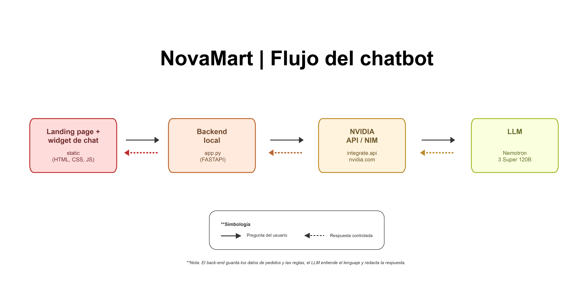
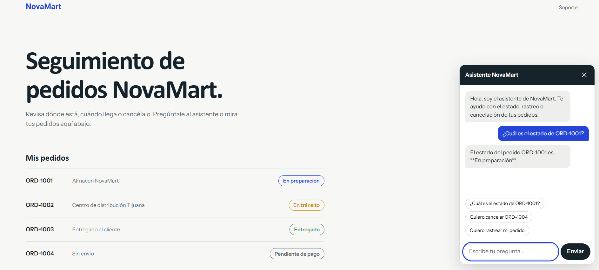
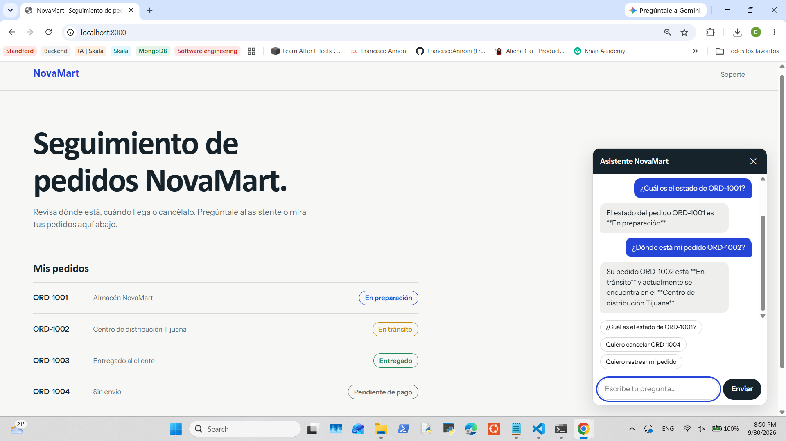
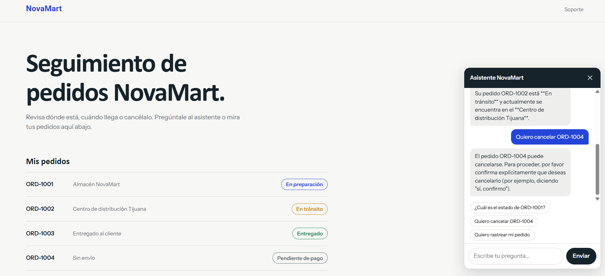
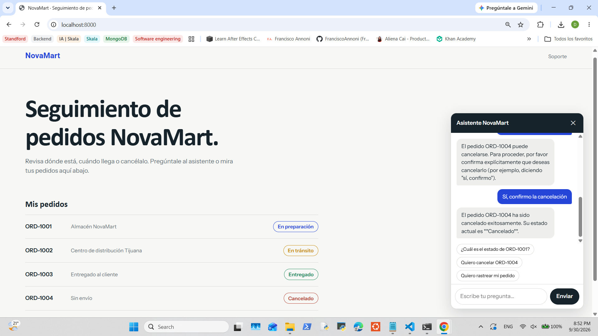
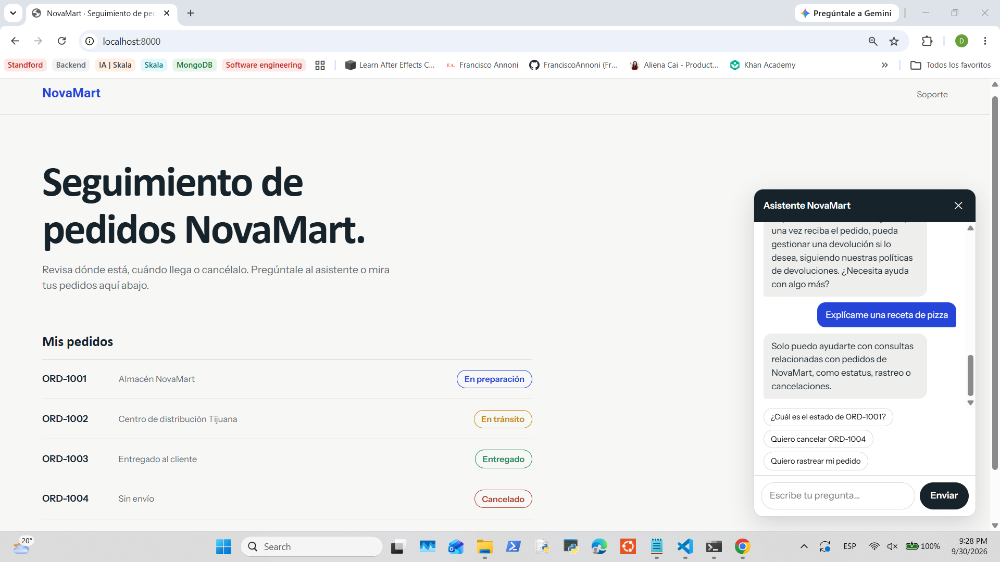

# NovaMart: Landing Page y Chatbot con NVIDIA NIM

🇬🇧 [Read in English](README.md)

**Autor:** Diego Galicia Salgado (asignado al Equipo 2; desarrollo e implementación individual)
**Curso:** I Bootcamp Skala (IA) · Presentación: 30 de septiembre de 2026

## Objetivo

Construir una landing page funcional en localhost para la empresa ficticia NovaMart, con un widget de chatbot conectado a un LLM de NVIDIA mediante API/NIM. El chatbot atiende únicamente consultas de pedidos: estado, rastreo y cancelación.

## Tecnologías

- **Frontend:** HTML, CSS y JavaScript (sin frameworks).
- **Backend:** Python 3.12 + FastAPI + Uvicorn.
- **LLM:** `nvidia/nemotron-3-super-120b-a12b`, consumido con el cliente `openai` apuntando al endpoint de NVIDIA.
- **Configuración:** `python-dotenv` para leer la API Key desde `.env`.

## Explicación del flujo



1. El usuario abre la landing en `http://localhost:8000` y escribe en el widget.
2. El navegador envía el historial de la conversación a `POST /api/chat`.
3. El backend agrega el prompt de sistema y llama a NVIDIA NIM, indicándole qué funciones puede usar.
4. Si el LLM pide una función (`consultar_pedido`, `rastrear_envio`, `validar_cancelacion` o `cancelar_pedido`), el backend la ejecuta con los datos simulados y devuelve el resultado al LLM.
5. El LLM redacta la respuesta final y el backend la regresa al widget. Si hubo una cancelación, la lista de pedidos se actualiza.

## Qué parte es cada cosa

| Parte | Dónde está | Qué hace |
| --- | --- | --- |
| Landing page | `static/index.html`, `styles.css`, `script.js` | Muestra los pedidos y el widget del chat |
| Backend local | `app.py` | Guarda los datos simulados, ejecuta las funciones y aplica las reglas |
| NVIDIA API / NIM | `integrate.api.nvidia.com` | Servicio de inferencia que recibe el texto y ejecuta el modelo |
| LLM | Nemotron 3 Super 120B | Entiende lo que escribe el usuario y redacta la respuesta |

## Cómo limito el comportamiento del chatbot

- **Prompt de sistema** que restringe el tema a pedidos y define la frase exacta para temas fuera de alcance.
- **Funciones simuladas:** el LLM no inventa estados; consulta los datos del backend.
- **Seguro en código:** `cancelar_pedido` solo cancela si antes se validó la cancelación de ese pedido y el usuario confirmó. Esto no depende del LLM.
- **Errores controlados:** si falla la conexión con NVIDIA, el usuario ve un mensaje genérico y el detalle queda solo en la terminal.

## Cómo ejecutar en localhost

```bash
git clone https://github.com/galsdig/novamart-landing-chatbot.git
cd novamart-landing-chatbot
python3 -m venv venv
source venv/bin/activate
pip install -r requirements.txt
cp .env.example .env     # luego edita .env con tu API Key
uvicorn app:app --reload
```

Abre `http://localhost:8000`.

## Cómo configurar la API Key sin exponerla

1. Genera una clave en [build.nvidia.com](https://build.nvidia.com).
2. Copia `.env.example` a `.env` y reemplaza `tu_clave_aqui` por tu clave.
3. `.env` está en `.gitignore`, por lo que **nunca se sube a GitHub**. Solo se versiona `.env.example`, que no tiene credenciales reales.

## Pruebas realizadas

Tabla de rendimiento del chatbot

| Prueba | Resultado | Observación |
| --- | --- | --- |
| ¿Cuál es el estado de ORD-1001? |✅| El estado del pedido ORD-1001 es **En preparación**. |
| ¿Dónde está mi pedido ORD-1002? |✅| Su pedido ORD-1002 está **En tránsito** y actualmente se encuentra en el **Centro de distribución Tijuana**. |
| Quiero cancelar ORD-1004 |✅| El pedido ORD-1004 puede cancelarse. Para proceder, por favor confirma explícitamente que deseas cancelarlo (por ejemplo, diciendo "sí, confirmo"). |
| Sí, confirmo la cancelación |✅| El pedido ORD-1004 ha sido cancelado exitosamente. Su estado actual es **Cancelado**. |
| Cancela ORD-1002 |✅| No se puede cancelar el pedido ORD-1002 porque ya fue enviado y está en camino. En este estado, el proceso de envío ya ha iniciado y no es posible detenerlo. Le sugiero que, una vez reciba el pedido, pueda gestionar una devolución si lo desea, siguiendo nuestras políticas de devoluciones. ¿Necesita ayuda con algo más? |
| Quiero rastrear mi pedido (sin número) |✅| Para poder rastrear tu pedido, necesito el número de orden. ¿Podrías proporcionarme el número de tu pedido (ejemplo: ORD-1001)? |
| Explícame una receta de pizza |✅| Solo puedo ayudarte con consultas relacionadas con pedidos de NovaMart, como estatus, rastreo o cancelaciones. |
| Hazme un poema |✅| Solo puedo ayudarte con consultas relacionadas con pedidos de NovaMart, como estatus, rastreo o cancelaciones. |
| ¿Cuánto es 25 por 18? |✅| Solo puedo ayudarte con consultas relacionadas con pedidos de NovaMart, como estatus, rastreo o cancelaciones. |
| Dime información sobre política |✅| Solo puedo ayudarte con consultas relacionadas con pedidos de NovaMart, como estatus, rastreo o cancelaciones. |
| Recomiéndame una película |✅| Solo puedo ayudarte con consultas relacionadas con pedidos de NovaMart, como estatus, rastreo o cancelaciones. |

## Evidencia del funcionamiento

### Estado de pedido


### Rastreo


### Cancelación
El chatbot valida el pedido, pide confirmación y solo cancela si el usuario confirma.





### Preguntas fuera de tema



## Conclusión

En este proyecto aprendí a integrar un modelo de lenguaje (LLM) en una aplicación web local usando la API de NVIDIA. Mi backend en FastAPI recibe el mensaje desde el widget, lo envía a la API de NVIDIA NIM junto con el prompt de sistema y las funciones disponibles, y el modelo Nemotron redacta la respuesta final. Usé el servicio alojado de NVIDIA mediante una API Key, por lo que no desplegué ningún contenedor propio.

También entendí que el LLM y la aplicación local cumplen funciones distintas. El LLM interpreta el lenguaje del usuario y redacta las respuestas, mientras que la aplicación guarda los datos de los pedidos y aplica las reglas. Para limitar el comportamiento del chatbot combiné un prompt de sistema con funciones simuladas (consultar, rastrear, validar y cancelar) y una validación en el código: un pedido solo se cancela si antes se validó y el usuario lo confirmó. Como el modelo no recuerda la conversación por sí solo, el navegador reenvía el historial en cada petición.

Entre las dificultades que encontré estuvieron la configuración de la API Key en el archivo `.env` sin exponerla en GitHub, activar el entorno virtual para que el servidor encendiera y diferenciar el entorno de Linux (Ubuntu en WSL) del sistema de archivos de Windows. También noté que los pedidos simulados conservan su estado mientras el servidor sigue encendido, por lo que tenía que reiniciarlo para repetir las pruebas de cancelación, y que el modelo a veces devolvía formato Markdown, lo cual corregí ajustando el prompt de sistema.

Como resultado, el chatbot responde correctamente sobre estatus, rastreo y cancelación, pide el número de pedido cuando falta y redirige las preguntas fuera de tema con la frase definida en la actividad.

## Desarrollo asistido por IA

Utilicé un asistente de IA (Claude, de Anthropic) como herramienta de apoyo durante este proyecto: para revisar y mejorar la documentación, estructurar este README bilingüe y guiarme en el flujo de Git/WSL y en las revisiones del repositorio antes de publicarlo. Diseñé la solución, implementé y probé el chatbot, y validé los resultados yo mismo.

## Autor

**Diego Galicia Salgado** · [](https://www.linkedin.com/in/dgsalgado/)

## Licencia

MIT (ver [`LICENSE`](LICENSE)).
