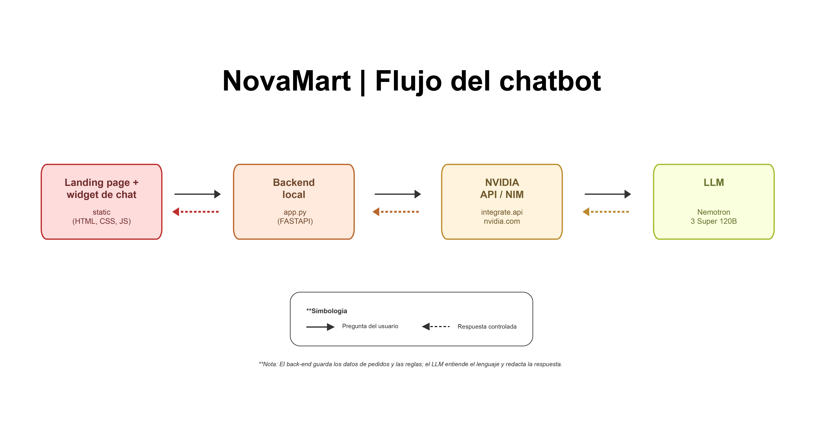
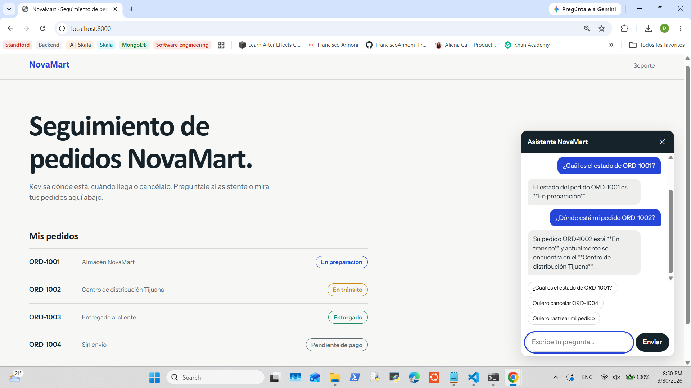
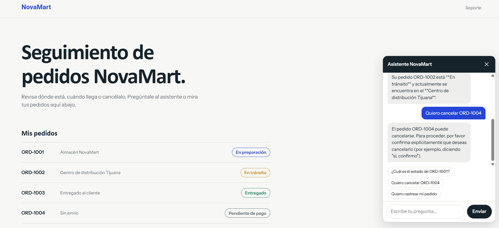
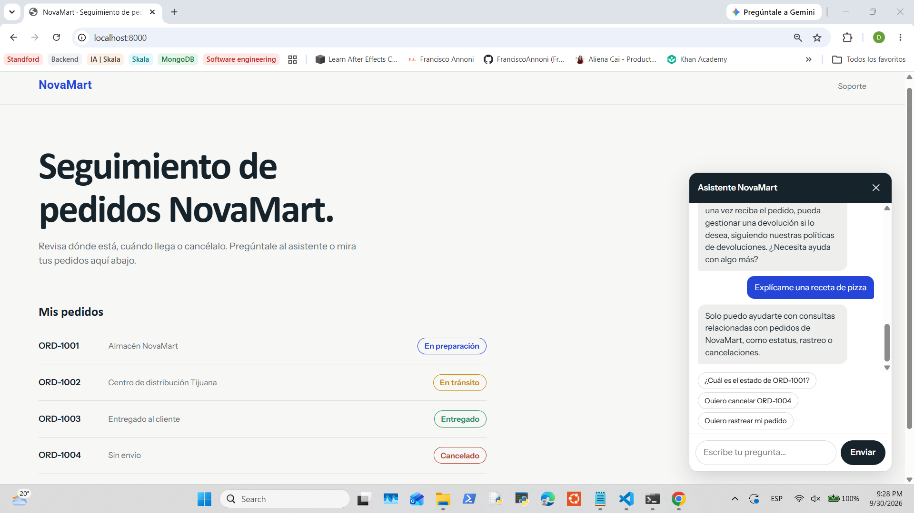

# NovaMart: Landing Page and Chatbot with NVIDIA NIM

🇪🇸 [Leer en español](README.es.md)

**Author:** Diego Galicia Salgado (assigned to Team 2; individual development and implementation)
**Course:** Skala Bootcamp I (AI) · Presentation: September 30, 2026

## Objective

Build a functional landing page on localhost for the fictional company NovaMart, with a chatbot widget connected to an NVIDIA LLM through API/NIM. The chatbot only handles order inquiries: status, tracking and cancellation.

## Technologies

- **Frontend:** HTML, CSS and JavaScript (no frameworks).
- **Backend:** Python 3.12 + FastAPI + Uvicorn.
- **LLM:** `nvidia/nemotron-3-super-120b-a12b`, consumed with the `openai` client pointing to the NVIDIA endpoint.
- **Configuration:** `python-dotenv` to read the API Key from `.env`.

## How the flow works



1. The user opens the landing page at `http://localhost:8000` and types in the widget.
2. The browser sends the conversation history to `POST /api/chat`.
3. The backend adds the system prompt and calls NVIDIA NIM, telling it which functions it can use.
4. If the LLM requests a function (`consultar_pedido`, `rastrear_envio`, `validar_cancelacion` or `cancelar_pedido`), the backend runs it with the simulated data and returns the result to the LLM.
5. The LLM writes the final answer and the backend returns it to the widget. If an order was cancelled, the order list is updated.

## What each part is

| Part | Where it is | What it does |
| --- | --- | --- |
| Landing page | `static/index.html`, `styles.css`, `script.js` | Shows the orders and the chat widget |
| Local backend | `app.py` | Stores the simulated data, runs the functions and applies the rules |
| NVIDIA API / NIM | `integrate.api.nvidia.com` | Inference service that receives the text and runs the model |
| LLM | Nemotron 3 Super 120B | Understands what the user writes and writes the reply |

## How I limit the chatbot's behavior

- **System prompt** that restricts the topic to orders and defines the exact phrase for out-of-scope topics.
- **Simulated functions:** the LLM does not invent statuses; it queries the backend data.
- **Safeguard in code:** `cancelar_pedido` only cancels if the cancellation of that order was validated first and the user confirmed. This does not depend on the LLM.
- **Handled errors:** if the connection to NVIDIA fails, the user sees a generic message and the details stay only in the terminal.

## How to run on localhost

```bash
git clone https://github.com/galsdig/novamart-landing-chatbot.git
cd novamart-landing-chatbot
python3 -m venv venv
source venv/bin/activate
pip install -r requirements.txt
cp .env.example .env     # then edit .env with your API Key
uvicorn app:app --reload
```

Open `http://localhost:8000`.

## How to configure the API Key without exposing it

1. Generate a key at [build.nvidia.com](https://build.nvidia.com).
2. Copy `.env.example` to `.env` and replace `tu_clave_aqui` with your key.
3. `.env` is in `.gitignore`, so it is **never uploaded to GitHub**. Only `.env.example` is versioned, and it contains no real credentials.

## Tests performed

Chatbot performance table

> The chatbot works in Spanish. The user messages and replies below are translated into English; the original text is in [README.es.md](README.es.md). The screenshots show the Spanish interface. The out-of-scope phrase defined in the code is: *"Solo puedo ayudarte con consultas relacionadas con pedidos de NovaMart, como estatus, rastreo o cancelaciones."*

| Test | Result | Observation |
| --- | --- | --- |
| What is the status of ORD-1001? |✅| The status of order ORD-1001 is **In preparation**. |
| Where is my order ORD-1002? |✅| Your order ORD-1002 is **In transit** and is currently at the **Tijuana distribution center**. |
| I want to cancel ORD-1004 |✅| Order ORD-1004 can be cancelled. To proceed, please explicitly confirm that you want to cancel it (for example, by saying "yes, I confirm"). |
| Yes, I confirm the cancellation |✅| Order ORD-1004 has been successfully cancelled. Its current status is **Cancelled**. |
| Cancel ORD-1002 |✅| Order ORD-1002 cannot be cancelled because it has already shipped and is on its way. In this state, the shipping process has already started and cannot be stopped. I suggest that once you receive the order, you can request a return if you wish, following our return policies. Do you need help with anything else? |
| I want to track my order (no number) |✅| To track your order, I need the order number. Could you provide your order number (example: ORD-1001)? |
| Explain a pizza recipe to me |✅| I can only help you with queries related to NovaMart orders, such as status, tracking or cancellations. |
| Write me a poem |✅| I can only help you with queries related to NovaMart orders, such as status, tracking or cancellations. |
| How much is 25 times 18? |✅| I can only help you with queries related to NovaMart orders, such as status, tracking or cancellations. |
| Tell me about politics |✅| I can only help you with queries related to NovaMart orders, such as status, tracking or cancellations. |
| Recommend a movie to me |✅| I can only help you with queries related to NovaMart orders, such as status, tracking or cancellations. |

## Evidence of operation

### Order status


### Tracking


### Cancellation
The chatbot validates the order, asks for confirmation and only cancels if the user confirms.




### Out-of-scope questions



## Conclusion

In this project I learned to integrate a large language model (LLM) into a local web application using the NVIDIA API. My FastAPI backend receives the message from the widget, sends it to the NVIDIA NIM API together with the system prompt and the available functions, and the Nemotron model writes the final answer. I used NVIDIA's hosted service through an API Key, so I did not deploy any container of my own.

I also understood that the LLM and the local application serve different functions. The LLM interprets the user's language and writes the replies, while the application stores the order data and applies the rules. To limit the chatbot's behavior I combined a system prompt with simulated functions (query, track, validate and cancel) and a validation in the code: an order is only cancelled if it was validated beforehand and the user confirmed it. Since the model does not remember the conversation on its own, the browser resends the history with each request.

Among the difficulties I encountered were configuring the API Key in the `.env` file without exposing it on GitHub, activating the virtual environment so the server would start, and telling the Linux environment (Ubuntu on WSL) apart from the Windows file system. I also noticed that the simulated orders keep their state while the server stays on, so I had to restart it to repeat the cancellation tests, and that the model sometimes returned Markdown formatting, which I fixed by adjusting the system prompt.

As a result, the chatbot answers correctly about status, tracking and cancellation, asks for the order number when it is missing, and redirects out-of-scope questions with the phrase defined in the activity.

## AI-assisted development

I used an AI assistant (Claude, by Anthropic) as a support tool during this project: to review and improve the documentation, to structure this bilingual README, and to guide me through the Git/WSL workflow and the repository checks before publishing. I designed the solution, implemented and tested the chatbot, and validated the results myself.

## Author

**Diego Galicia Salgado** · [](https://www.linkedin.com/in/dgsalgado/)

## License

MIT (see [`LICENSE`](LICENSE)).
