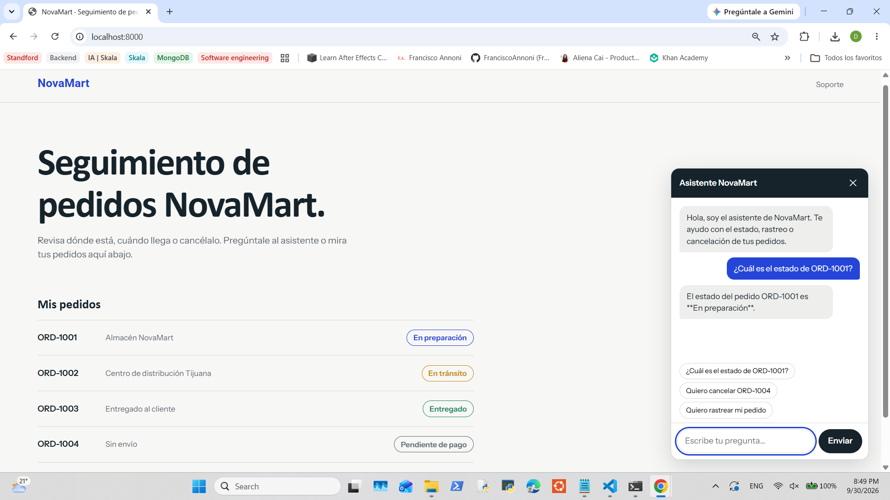
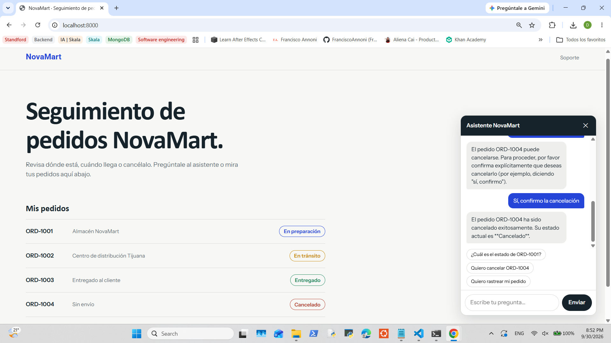

# NovaMart: landing page y chatbot con NVIDIA NIM

**Equipo 2:** Mario, José Miguel, Yassir y Diego
**Curso:** I Bootcamp Skala (IA) · Presentación: 30 de septiembre de 2026

## Objetivo

Construir una landing page funcional en localhost para la empresa ficticia NovaMart, con un widget de chatbot conectado a un LLM de NVIDIA mediante API/NIM. El chatbot atiende únicamente consultas de pedidos: estado, rastreo y cancelación.

## Tecnologías

- **Frontend:** HTML, CSS y JavaScript (sin frameworks).
- **Backend:** Python 3.12 + FastAPI + Uvicorn.
- **LLM:** `nvidia/nemotron-3-super-120b-a12b`, consumido con el cliente `openai` apuntando al endpoint de NVIDIA.
- **Configuración:** `python-dotenv` para leer la API Key desde `.env`.

## Explicación del flujo


1. El usuario abre la landing en `http://localhost:8000` y escribe en el widget.
2. El navegador envía el historial de la conversación a `POST /api/chat`.
3. El backend agrega el prompt de sistema y llama a NVIDIA NIM, indicándole qué funciones puede usar.
4. Si el LLM pide una función (`consultar_pedido`, `rastrear_envio`, `validar_cancelacion` o `cancelar_pedido`), el backend la ejecuta con los datos simulados y devuelve el resultado al LLM.
5. El LLM redacta la respuesta final y el backend la regresa al widget. Si hubo una cancelación, la lista de pedidos se actualiza.

## Qué parte es cada cosa

| Parte | Dónde está | Qué hace |
| --- | --- | --- |
| Landing page | `static/index.html`, `styles.css`, `script.js` | Muestra los pedidos y el widget del chat |
| Backend local | `app.py` | Guarda los datos simulados, ejecuta las funciones y aplica las reglas |
| NVIDIA API / NIM | `integrate.api.nvidia.com` | Servicio de inferencia que recibe el texto y ejecuta el modelo |
| LLM | Nemotron 3 Super 120B | Entiende lo que escribe el usuario y redacta la respuesta |

## Cómo limitamos el comportamiento del chatbot

- **Prompt de sistema** que restringe el tema a pedidos y define la frase exacta para temas fuera de alcance.
- **Funciones simuladas:** el LLM no inventa estados; consulta los datos del backend.
- **Seguro en código:** `cancelar_pedido` solo cancela si antes se validó la cancelación de ese pedido y el usuario confirmó. Esto no depende del LLM.
- **Errores controlados:** si falla la conexión con NVIDIA, el usuario ve un mensaje genérico y el detalle queda solo en la terminal.

## Cómo ejecutar en localhost

```bash
git clone https://github.com/galsdig/novamart-landing-chatbot.git
cd novamart-landing-chatbot
python3 -m venv venv
source venv/bin/activate
pip install -r requirements.txt
cp .env.example .env     # luego edita .env con tu API Key
uvicorn app:app --reload
```

Abre `http://localhost:8000`.

## Cómo configurar la API Key sin exponerla

1. Genera una clave en [build.nvidia.com](https://build.nvidia.com).
2. Copia `.env.example` a `.env` y reemplaza `tu_clave_aqui` por tu clave.
3. `.env` está en `.gitignore`, por lo que **nunca se sube a GitHub**. Solo se versiona `.env.example`, que no tiene credenciales reales.

## Pruebas realizadas

Tabla de rendimiento del chatbot

| Prueba | Resultado | Observación |
| --- | --- | --- |
| ¿Cuál es el estado de ORD-1001? | ✅ | El estado del pedido ORD-1001 es **En preparación**. |
| ¿Dónde está mi pedido ORD-1002? | ✅ | Su pedido ORD-1002 está **En tránsito** y actualmente se encuentra en el **Centro de distribución Tijuana**. |
| Quiero cancelar ORD-1004 | ✅ | El pedido ORD-1004 puede cancelarse. Para proceder, por favor confirma explícitamente que deseas cancelarlo (por ejemplo, diciendo "sí, confirmo"). |
| Sí, confirmo la cancelación | ✅ | El pedido ORD-1004 ha sido cancelado exitosamente. Su estado actual es **Cancelado**. |
| Cancela ORD-1002 | ✅ | No se puede cancelar el pedido ORD-1002 porque ya fue enviado y está en camino. En este estado, el proceso de envío ya ha iniciado y no es posible detenerlo. Le sugiero que, una vez reciba el pedido, pueda gestionar una devolución si lo desea, siguiendo nuestras políticas de devoluciones. ¿Necesita ayuda con algo más? |
| Quiero rastrear mi pedido (sin número) | ✅ | Para poder rastrear tu pedido, necesito el número de orden. ¿Podrías proporcionarme el número de tu pedido (ejemplo: ORD-1001)? |
| Explícame una receta de pizza | ✅ | Solo puedo ayudarte con consultas relacionadas con pedidos de NovaMart, como estatus, rastreo o cancelaciones. |
| Hazme un poema | ✅ | Solo puedo ayudarte con consultas relacionadas con pedidos de NovaMart, como estatus, rastreo o cancelaciones. |
| ¿Cuánto es 25 por 18? | ✅ | Solo puedo ayudarte con consultas relacionadas con pedidos de NovaMart, como estatus, rastreo o cancelaciones. |
| Dime información sobre política | ✅ | Solo puedo ayudarte con consultas relacionadas con pedidos de NovaMart, como estatus, rastreo o cancelaciones. |
| Recomiéndame una película | ✅ | Solo puedo ayudarte con consultas relacionadas con pedidos de NovaMart, como estatus, rastreo o cancelaciones. |

## Evidencia del funcionamiento

### Estado de pedido


### Rastreo


### Cancelación
El chatbot valida el pedido, pide confirmación y solo cancela si el usuario confirma.




### Preguntas fuera de tema


## Conclusión del equipo

> En este proyecto aprendimos cómo integrar un modelo de lenguaje grande (LLM) en una aplicación web local mediante **NVIDIA NIM** (NVIDIA Inference Microservices). Por lo que, comprendimos que NVIDIA NIM, puede facilitar el despliegue de modelos de inteligencia artificial por medio de contenedores y microservicios optimizados, permitiendo realizar peticiones de inferencia de manera rápida y eficiente a través de una API REST. Asi que, conectamos la interfaz gráfica local mediante un cliente HTTP en el backend, enviando el historial de conversación en cada petición para mantener el contexto del diálogo sin depender del estado interno del modelo.
 
> Sin embargo, entre las principales dificultades que pudimos encontrar estuvieron la configuración inicial de la clave de API y la variable de entorno para conectar con los endpoints de NVIDIA, la estructuración correcta del payload en formato JSON enviado al servidor, el manejo asíncrono de las respuestas en el navegador para garantizar una experiencia fluida de usuario, y la sincronización entre el estado de las conversaciones y la actualización dinámica de la interfaz de usuario.
